<h1>
  
  <span style="vertical-align: middle;">AI-on-the-Edge Device 2.0 "Grrzzz"</span>
</h1>

Digitize your water, gas or electricity meter with a 10 euro ESP32-CAM. The device takes a picture of the meter, reads the digits
with a neural network directly on the chip and sends the value to Home Assistant, MQTT, InfluxDB or whatever you like.

This is my personal fork of [Slider0007's SLFork](https://github.com/Slider0007/AI-on-the-edge-device), which itself continues
[jomjol's AI-on-the-Edge Device](https://github.com/jomjol/AI-on-the-edge-device). Release 2.0 replaces the web interface with a
single page app in the style of my [FingerprintDoorbell](https://github.com/Grrzzz/FingerprintDoorbell) fork, adds a JSON REST
backend and a one-click update from GitHub, and trims the firmware to the `esp32cam` board.

<p align="center">
  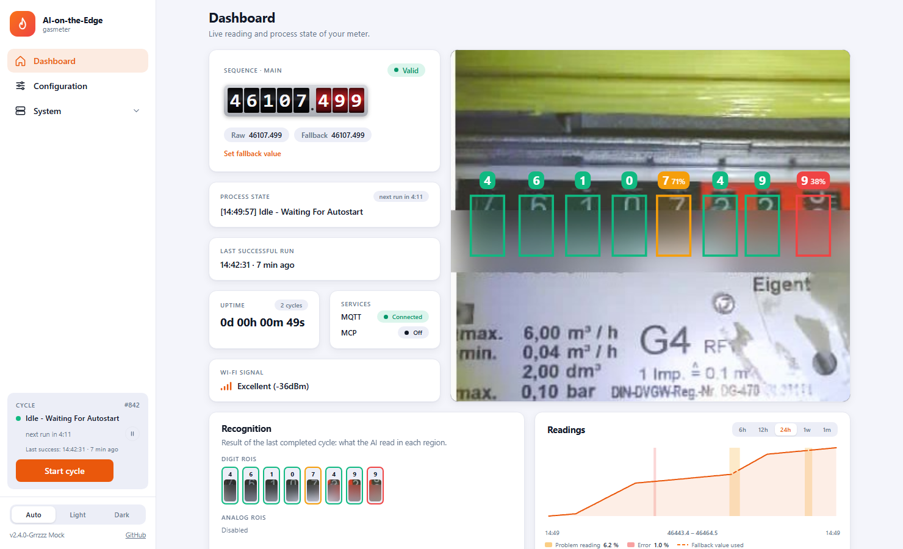
</p>

## What is new in 2.4

- **Configuration for phones and tablets - and for the desktop** - the editor was rebuilt around one control layer: a number sequence
  combo box with the switches for digits and analog (rename, delete and add right in the list), a region combo box with a preview of every
  region (move up and down, copy, delete, add), a position pad with a jog stick, steppers for the size and options. The image floats
  while you scroll, regions can be dragged with the finger, and "Zoom in" follows the selected region. The same layout is used on
  the desktop (image left, controls right). Regions and markers are drawn like on the dashboard, the selected one in the accent color
- **Image tab simplified** - one "Update image" button, the settings are blurred until a picture was taken. Rotation, zoom, flash,
  brightness and the other camera values are sliders with -/+ buttons, mirror and flip are switches, everything rarely needed sits behind
  an **Advanced** switch (remembered in the browser)
- **MCP server (beta)** - optional [Model Context Protocol](docs/API/REST/mcp.md) server on the device. An assistant such as Claude can read
  status, recognition and images, place alignment markers and regions, change settings and start cycles. Off by default, protected by a
  token that the device generates (it survives restarts), system actions (delete files, reboot, update) behind a second switch.
  Manage it under `System > MCP`. **Beta: compiled and tested against the web interface mock, not yet over a longer time on a device**
- **Dashboard** - a pill with the number of cycles in the uptime card, a services card (MQTT, MCP), rolling counter digits, the
  countdown as a pill in the process state, no second animation after a manual start
- **Models** - the model combo shows age, size and typical use of each model with a short help text
- Fix: the confidence of the `class100` models is computed with a softmax (digits showed 0 %, analog 100 %). Compiled, not yet checked
  on a device
- Fix: toggling digits or analog in the configuration no longer jumps to another tab

## What is new in 2.3

- **Menu entries are real links** - the middle mouse button, Ctrl/Shift + click and the context menu open a page in a new tab
- **Mobile:** the top bar with the host name floats above the content, hides while scrolling down and comes back after a short scroll up
- **Configuration > Markers** shows the recognition of the last cycle (results and the last alignment), so a marker change can be judged
  by its effect; it reloads after every cycle
- **Pause button** reacts right away, also while a cycle runs or the device is busy
- A tab in the background is no lost connection any more (the title says "(no connection)" only if the device really does not answer)
- Fix: the dashboard opened while a cycle is running no longer fails. The refresh button is gone (the dashboard follows the device)

## What is new in 2.2

- **Picture animation in the dashboard** - the image card follows the device while a cycle runs: the scan scene ("Taking image", the
  step names), the raw image grows out of the scan icon, the markers are searched, the image is rotated and shifted onto the reference,
  the regions of interest appear and every digit and analog region takes the color of its result (green recognized, orange uncertain,
  red low confidence) while the device evaluates it. The recognition card is blurred while the new results are on the way and its tiles
  fill one after another. A replay button runs the animation again. While a web interface is open the device pauses briefly after each step
  so the steps can be followed (no slow down without a web interface)
- **Firmware: `GET /api/live`** reports the progress of the running cycle, `/img_tmp/raw.jpg` the raw camera image of the last cycle,
  `/api/recognition` the alignment (rotation and shift), the confidence and the rectangle of every ROI
  ([API docs](docs/API/REST/live.md))
- **Hint for newer releases** - an info icon next to the version and a dot at the Update menu; the update page checks right away.
  Development builds can always be updated to the official release
- **Migration of v16** now keeps the MQTT password
- Tab title starts with the host name (with several devices in narrow tabs), favicon with a status dot, mobile dashboard shows the
  camera image as the second card

## What is new in 2.1

- **Countdown and pause** - in automatic mode the sidebar shows the countdown to the next run instead of the idle time. A mini pause
  button stops the countdown while you configure the device (config mode), a manual start still works
- **Last successful run** - shown in the sidebar and on the dashboard
- **Readings plot** - minimal chart of the data log on the dashboard (6 h, 12 h, 24 h, 1 week, 1 month). Problem periods are shaded
  yellow (invalid data, rate problems) or red (errors), fallback values are drawn dashed, the legend shows the share of each
- **Color themes** - the main color of the interface follows the meter type (blue for generic). `System > Setup > General` has a
  "Meter Type & Theme" card with custom selection boxes: the meter type shows its icon, the theme (Blue, Orange, Amber, Pink,
  Slate) can be overridden. The icons always follow the meter type
- **Status favicon and tab title** - the favicon shows the meter icon with a status dot, the tab title gets a prefix on errors or pause
- **MQTT badge** on the dashboard, a 60 second total countdown in the update screen, smaller digit tiles in the recognition card
- Development builds can always be updated to the official release from `System > Update`

## What is new in 2.0

- **New web interface** - a single page app (`index.html`, `app.js`, `style.css`) with light and dark theme, a responsive layout for
  phones and a live cycle status in the sidebar (current process step, time in this state, Start cycle button)
- **Dashboard** - big counter display, status badge, the processed image with the regions of interest and the recognized digits
  and analog dials. While the camera takes a picture an animated scan scene is shown
- **Meter type icon themes** - water, gas, electricity, heat and more; icons, accent color and the animated process state images
  follow the meter type you configured
- **Guided setup** - Wizard for first start, tabbed Setup (General, Network, Recognition, MQTT, Camera, GPIO) with a save bar and
  a confirm dialog before anything is applied
- **Configuration editor** - reference image, alignment markers, digit and analog regions with live preview, plus quiet
  "How it works" help on every page
- **One-click update from GitHub** - `System > Update` checks the latest release of this repository, downloads it and flashes it with
  a progress overlay, just like the Doorbell. A manual upload of the release zip is still available
- **JSON REST API** - all former `.html` and text endpoints have JSON counterparts (`/api/status`, `/api/cycle`, `/api/fallback`,
  `/api/flow/*`, `/api/reboot`, `/api/update`, `/api/mqtt/*`, `/api/recognition`, `/fileserver/<dir>/?format=json`), see the
  [REST API documentation](docs/API/REST/_OVERVIEW.md)
- **Automatic migration of v16 installations** - the old `config.ini` (including Wi-Fi, hostname, GPIO and log level) is converted
  on first boot, models and images are carried over. A v16 backup can also be imported in the web interface
- **Less restrictive image validation** and a one-time wider search retry when the alignment marker is just outside the search field
- **Only `esp32cam`** - all other board variants were removed to keep the firmware small and testable

## Impressions

| Configuration | Regions of interest |
|:---:|:---:|
| 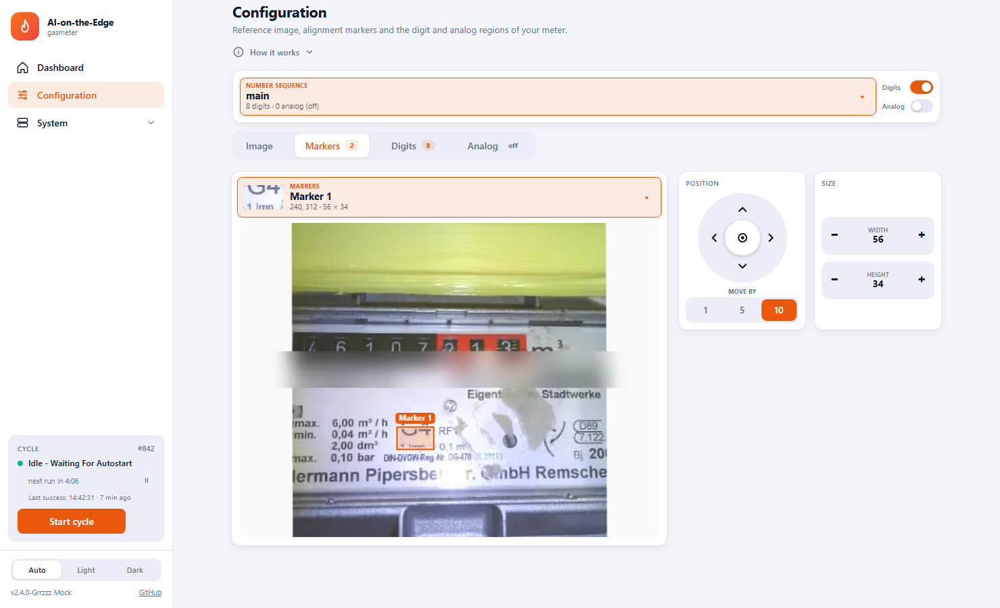 | 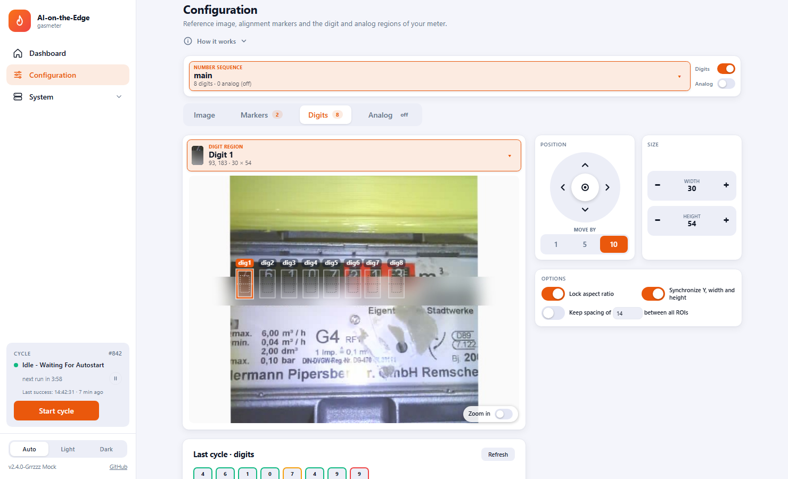 |

| Setup | Recognition |
|:---:|:---:|
| 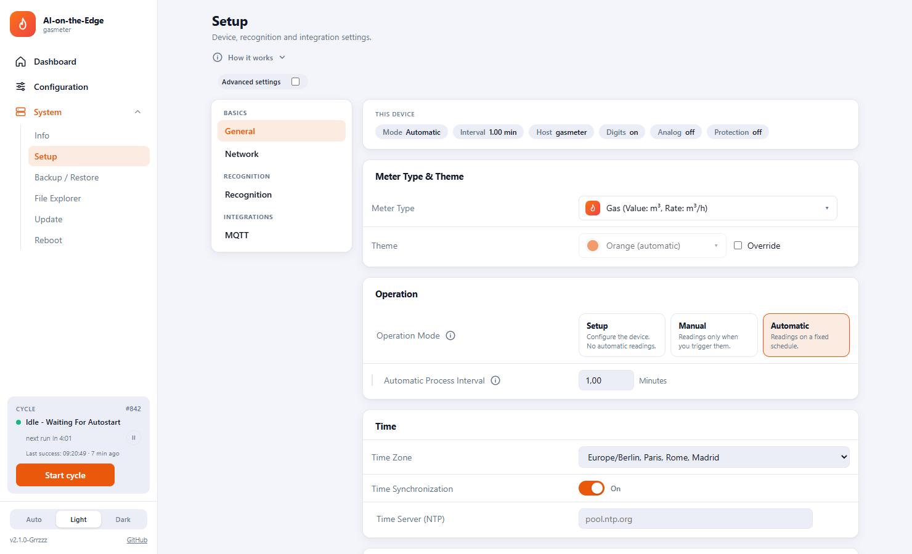 | 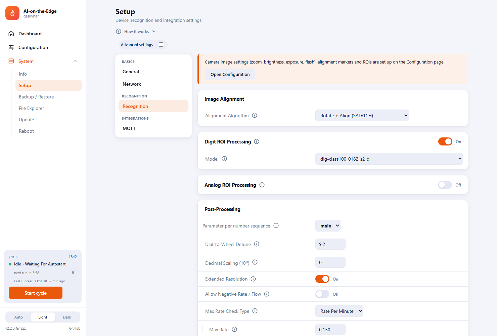 |

| System info | Update |
|:---:|:---:|
| 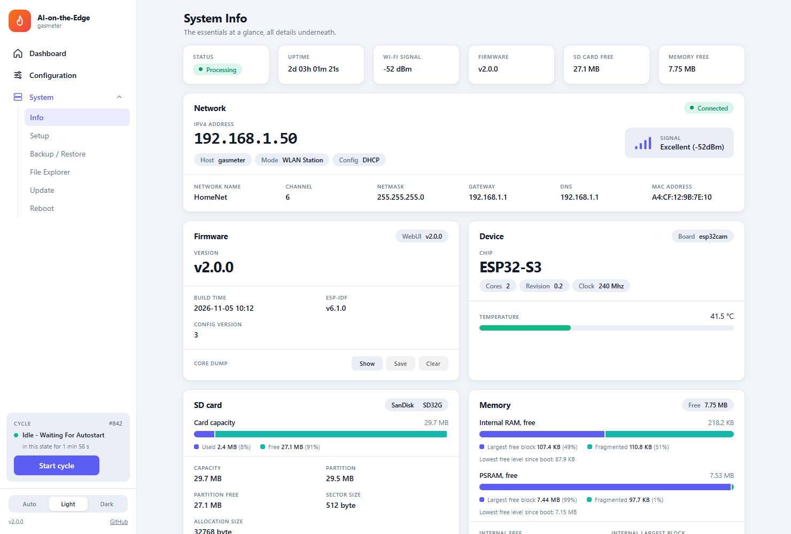 | 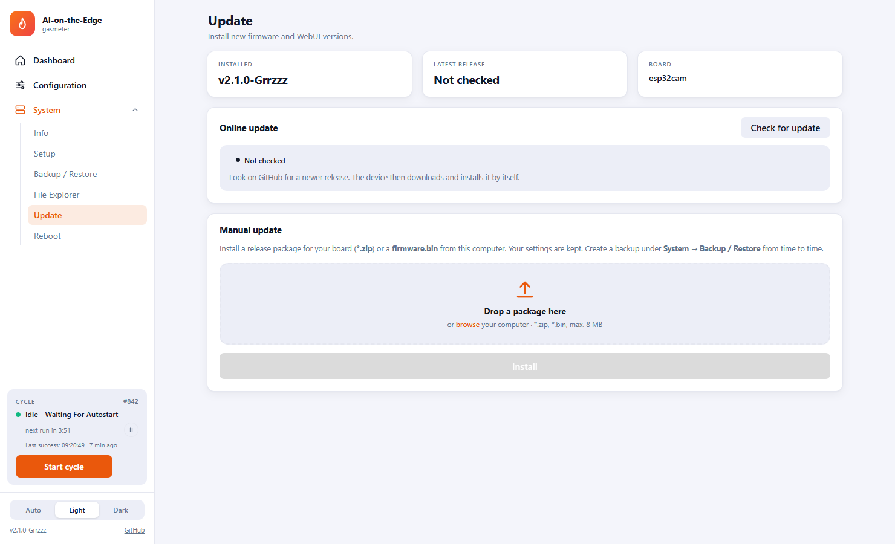 |

| File explorer | Dark theme |
|:---:|:---:|
| 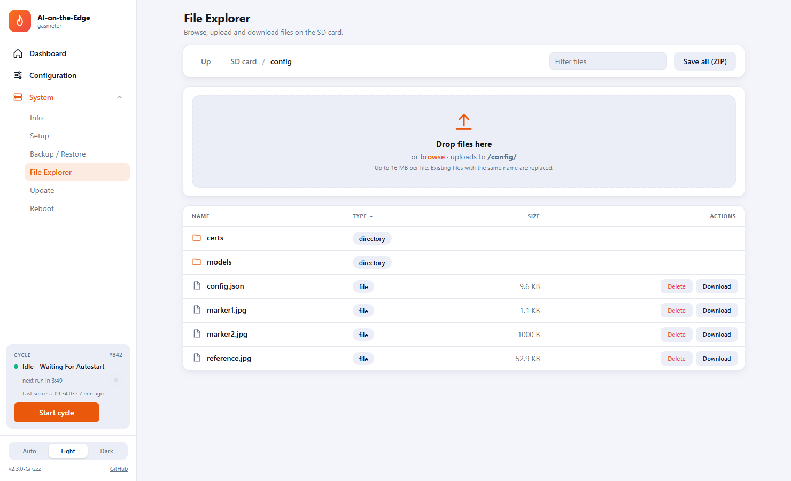 | 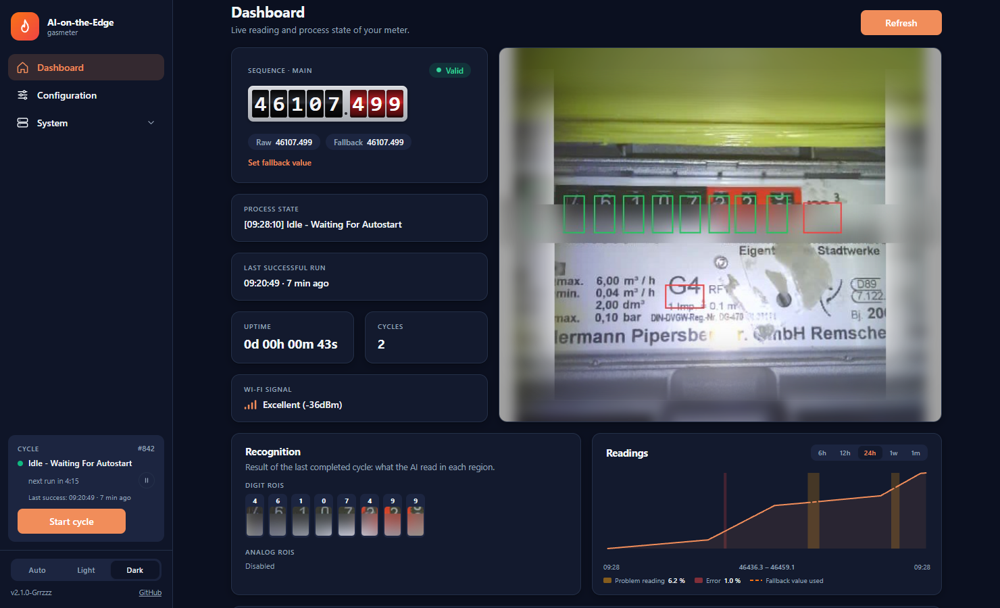 |

| MCP server (beta) |
|:---:|
| 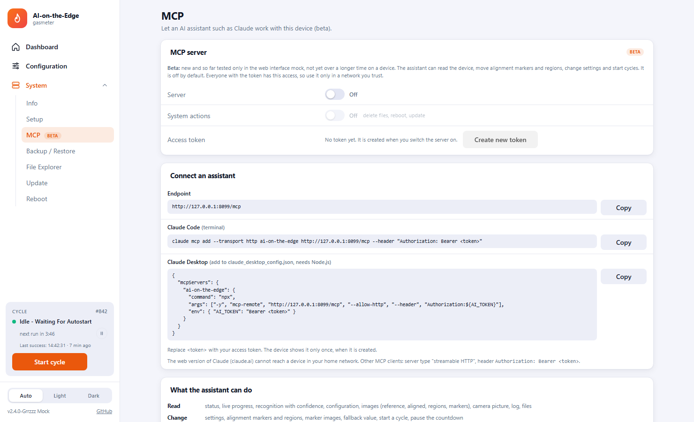 |

<p align="center">
  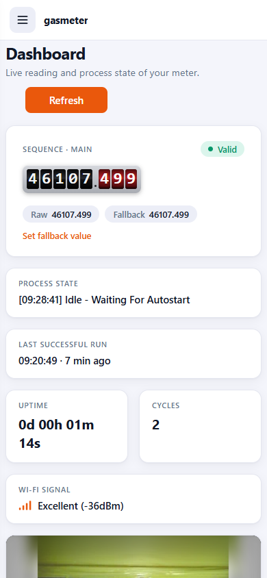
  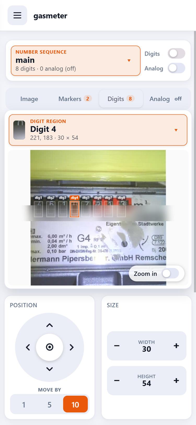
</p>

## Key features

- **Local image processing** - the picture is aligned, cut into regions and evaluated on the device, no cloud involved
- **On-device AI** - TensorFlow Lite models for digital and analog counters
- **Integrations** - [Home Assistant discovery](docs/API/MQTT/home-assistant-discovery.md), [MQTT](docs/API/MQTT/_OVERVIEW.md)
  (TLS supported), InfluxDB v1/v2, webhook, [REST](docs/API/REST/_OVERVIEW.md)
- **AI assistants (beta)** - optional [MCP server](docs/API/REST/mcp.md) so that Claude and friends can place markers and look after the device
- **Flashlight** - onboard LED or external PWM or smart LEDs
- **Easy maintenance** - backup and restore, file explorer, OTA update, dynamic config reload without reboot

## Supported hardware

| Board | SOC | Network | Flashlight | Firmware package |
|:---|:---|:---|:---|:---|
| [ESP32-CAM](images/boards/esp32-cam.png) | ESP32 | Wi-Fi client, Wi-Fi AP | Onboard LED (GPIO4, PWM) | `esp32cam` |

Cameras: OV2640 (2 MP), fixed focus. Boards need at least 4 MB flash and PSRAM.

## Installation

Download `AI-on-the-edge-device__esp32cam__grrzzz_release_<version>.zip` from the
[Releases page](https://github.com/Grrzzz/AI-on-the-edge-device/releases). Do not use the source files of the repository directly.

### First installation

1. Unpack the zip. It contains `bootloader.bin`, `partitions.bin`, `firmware.bin` and the SD card content (`config`, `html`).
2. Copy the SD card content to a FAT32 formatted SD card.
3. Flash the three binaries to the ESP32-CAM, for example with `esptool`:
   ```
   esptool.py --chip esp32 write_flash 0x1000 bootloader.bin 0x8000 partitions.bin 0x10000 firmware.bin
   ```
   (the partition layout is defined in `code/partitions_4MB_legacy.csv`)
4. Insert the card, power the device and connect to the Wi-Fi access point it opens. The wizard guides you through the rest.

### Update from an earlier release

Open `System > Update` in the web interface. The device finds the newest release on GitHub and installs it with one click.
Alternatively upload the release zip on the same page.

### Migration from v16 (jomjol)

1. Create a backup in the old web interface and keep it.
2. Update via `System > Update` (upload the release zip; ignore the file name warning).
3. On the first boot the old `config.ini` is converted automatically: Wi-Fi, hostname, GPIO, log level, markers, regions
   and the TensorFlow models are carried over.
4. Check the result in `Configuration` and `System > Setup`. Renew the reference image if the alignment is unstable.

If something is missing, `System > Backup / Restore` can import a v16 backup.

Developer notes for the web interface are in [docs/WebUI](docs/WebUI/README.md).

## Build yourself

```
cd code
python -m platformio run -e esp32cam
```

Set `RELEASE_VERSION=v2.0.0` to get a named release zip in `.builds/`. See the [Build / Developer Guide](docs/Development/Instructions.md).

## Credits and license

- [jomjol](https://github.com/jomjol/AI-on-the-edge-device) - the original AI-on-the-Edge Device
- [Slider0007](https://github.com/Slider0007/AI-on-the-edge-device) - the SLFork this release is based on
- Respect the upstream license, see [LICENSE.md](LICENSE.md). Use for non-commercial purposes and credit the original sources.

This fork is maintained for my own devices and published to give something back. Issues and feedback are welcome, support is
best effort.
